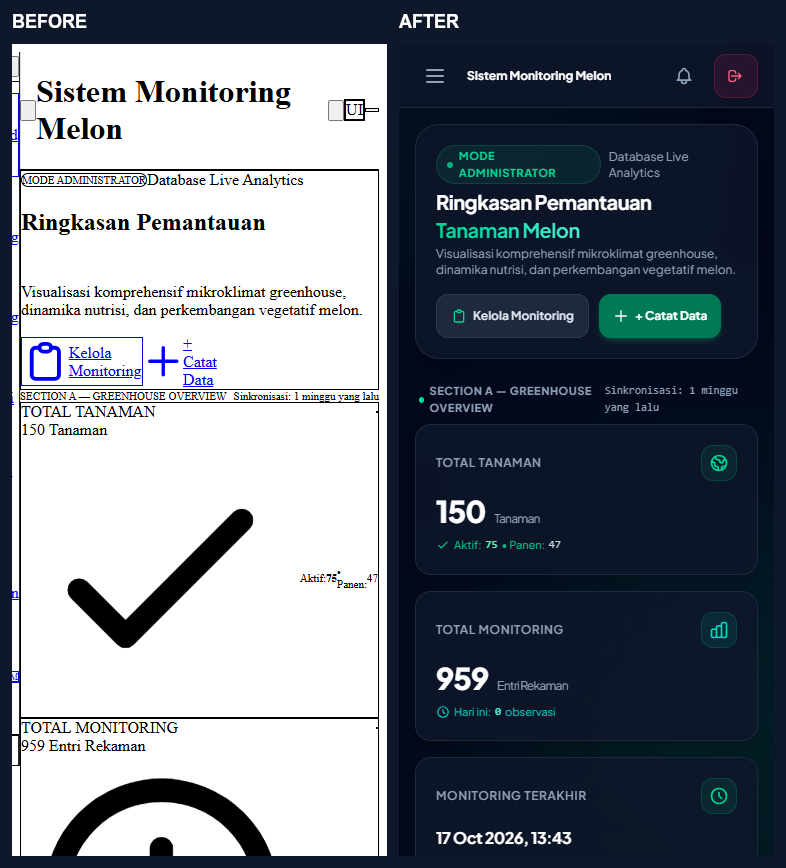

# Phase 16.3 — Visual Regression Report

Tanggal: **24 Oktober 2026 (Asia/Jakarta)**. Project existing: `D:\Compro`. Lingkup: pemulihan UI; tidak memulai Phase 16.4.

## PASS untuk pemulihan visual yang diperiksa

Tersedia **40 before +40 after screenshot viewport**,12 full-page after untuk dashboard/monitoring/fuzzy/aktuator/Sheets/reports pada375 dan1366, serta screenshot drawer, notifikasi, chart, validasi dan modal. Galeri perbandingan lokal dapat dibuka langsung: [visual-comparison.html](phase16_3/visual-comparison.html). Tersedia pula [mobile overview](phase16_3/screenshots/overview_375.png), [tablet](phase16_3/screenshots/overview_768.png), [laptop](phase16_3/screenshots/overview_1366.png), [desktop](phase16_3/screenshots/overview_1920.png).

## Perubahan overflow aktual

Before10 halaman ×4 viewport menunjukkan16 overflow; after0. Halaman lain yang tidak overflow sebelum fix tetap gagal tampilan dasar karena theme hilang, sehingga tidak diberi klaim baseline UI PASS.

| Halaman | Viewport width | Before document width | After document width |
| --- | --- | --- | --- |
| dashboard | 375 | 484 | 375 |
| charts | 375 | 484 | 375 |
| fuzzy | 375 | 502 | 375 |
| reports | 375 | 441 | 375 |
| dashboard | 768 | 877 | 768 |
| charts | 768 | 877 | 768 |
| fuzzy | 768 | 895 | 768 |
| reports | 768 | 834 | 768 |
| dashboard | 1366 | 1475 | 1366 |
| charts | 1366 | 1475 | 1366 |
| fuzzy | 1366 | 1493 | 1366 |
| reports | 1366 | 1432 | 1366 |
| dashboard | 1920 | 2029 | 1920 |
| charts | 1920 | 2029 | 1920 |
| fuzzy | 1920 | 2047 | 1920 |
| reports | 1920 | 1986 | 1920 |

Before: Times New Roman, background transparan, ikon terlalu besar. After: font lokal Plus Jakarta Sans dengan fallback system, background slate950, ukuran ikon/kartu/tabel dan navigasi mengikuti utilitas yang benar. Inspeksi mencakup contact sheet semua viewport, tampilan mobile/desktop, chart, form validation dan dialog. Screenshot full-page tersedia untuk komponen di bawah fold.

## Metode perbandingan

Semua gambar berasal dari browser aktual, bukan mockup. Script visuals.mjs membuat40 pasangan dan menghitung piksel berbeda dengan toleransi kanal20, disimpan di visual-comparisons.json. Besarnya perubahan memang diharapkan karena baseline rusak; **tidak menggunakan persentase selisih terhadap baseline rusak sebagai ambang PASS**. Acceptance ditentukan oleh layout, containment, metrics dan interaksi. Before/after bukan golden-image test pada semua commit mendatang.

Salinan data berasal dari DB utama yang sama, namun run interaksi terisolasi mengubah status/log aktuator dan log mock sync pada salinan; label waktu relatif juga bergerak. Selisih tersebut bukan perubahan histori utama. Browser animation/font readiness ditunggu; x-cloak menghilangkan flash drawer awal.

## Batas

Belum ada UAT pengguna, screenshot perangkat fisik/Safari/Firefox atau jaminan setiap pixel seluruh scroll state. Grafik null menampilkan empty-state dan backend query G12 tetap dicatat. Artefak PDF berhasil diunduh tetapi masalah footer/legenda PDF terdahulu G22 tidak diperbaiki pada fase UI web ini.
