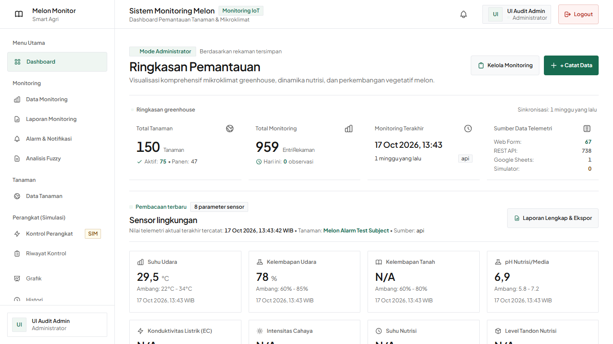

# UI Flat Design Refinement Report

Tanggal: **24 Oktober 2026**, project existing `D:\Compro`. Refinement presentation-only berdasarkan arahan putih, minimalis, flat dan data-first.

## Status: PASS dalam lingkup yang diverifikasi

Website existing kini memakai canvas putih, teks gelap, garis pemisah tipis dan aksen hijau gelap. Tidak membuat ulang project. Seluruh27 template web existing dirapikan dan satu komponen pembacaan sensor ditambahkan. Print PDF tetap dipertahankan.

## Keputusan desain

- Palet utama persis arahan: #FFFFFF, #F8F9FA, #171717, #666666, #E5E7EB, #176B50; error #B42318. Latar status lembut hanya untuk status/error/warning yang bermakna. Aksi edit dibuat netral.
- Gradient, glass/backdrop blur, glow, decorative shadow, animasi terus-menerus dan pill utama dihapus dari template web. Card2px, button/input4px, modal/dropdown4px, tabel0px.
- Overview menjadi deretan metrik dengan divider, bukan kumpulan kotak dekoratif. Section sensor/alarm/fuzzy/aktuator/integrasi memakai heading dan pemisah. Semua section A–G, filter dan tabel tetap tersedia; label region A/B existing dipertahankan untuk navigasi aksesibel.
- Delapan sensor mempunyai warna netral yang sama. Nilai dan unit dipisah, angka memakai tabular numbers, waktu pengamatan dicantumkan pada setiap sensor. Null tetap N/A; numeric0 tetap nilai.
- Grafik menggunakan hijau gelap untuk seri utama, grayscale untuk batas/seri pendamping dan kategori netral. Hanya properti tampilan yang diseragamkan; data, threshold, tooltip values, legend toggle dan query tidak diubah.
- Plus Jakarta Sans lokal dipertahankan. Page title24–28px, section16–18px, body14px, supporting12px, metrik24–32px. Field input konsisten44px. Kolom metrik tabel rata kanan, kolom tanaman/waktu tetap mengikuti semantiknya.
- Tombol mempunyai hover, pressed.98, focus-visible, disabled dan loading untuk POST native. Form yang sudah memiliki handler Alpine mempertahankan loading-nya sendiri. Prefers-reduced-motion dihormati. Delete tetap meminta konfirmasi; protected delete tetap menjelaskan alasan terkunci dengan teks terbaca.
- Home diperbarui menjadi penjelasan fungsi monitoring dan delapan parameter, menggantikan banner setup/framework/phase yang sudah usang. Link login/dashboard tetap ada. Login tetap memiliki pengisian akun demo lokal.

## Hasil verifikasi

| Pemeriksaan | Hasil |
| --- | --- |
| Before/after | **88 +88 screenshot viewport**,22 halaman ×4 viewport |
| Responsif | **88/88 PASS**,0 overflow dokumen,semua HTTP200 |
| Visual constraints | **0 gradient**,0 komponen yang diperiksa dengan radius>4px |
| Browser errors | **0 pageerror** pada run akhir |
| Alur utama | **52/52 PASS** |
| State dan CRUD terisolasi | **16/16 PASS** |
| Axe | **22 halaman**,0 detected WCAG violations; incomplete tetap dicatat |
| Laravel | **297 PASS /2075 assertions**,0 failure/error/skipped |
| Vite production build | **PASS**,63 modules,font lokal dibundel |
| Preservasi | Backend/config/routes/schema/tests dan PDF template hash identik;18 tabel utama identik,0 FK violations |

[Galeri before/after](ui_flat/visual-comparison.html), [verifikasi gabungan](ui_flat/evidence/verification.json), [komponen](UI_COMPONENT_INVENTORY.md), [interaksi](UI_INTERACTION_TEST_RESULTS.md), [responsif](UI_RESPONSIVE_VERIFICATION.md).

## File aplikasi yang berubah

Daftar berasal dari hash sebelum/sesudah pekerjaan ini, bukan seluruh perubahan Git project yang sudah ada:

- `resources/css/app.css`
- `resources/js/app.js`
- `resources/views/welcome.blade.php`
- `resources/views/actuators/history.blade.php`
- `resources/views/actuators/index.blade.php`
- `resources/views/alarms/index.blade.php`
- `resources/views/alarms/show.blade.php`
- `resources/views/alarms/thresholds.blade.php`
- `resources/views/auth/login.blade.php`
- `resources/views/components/status-badge.blade.php`
- `resources/views/components/summary-card.blade.php`
- `resources/views/dashboard/index.blade.php`
- `resources/views/fuzzy/history.blade.php`
- `resources/views/fuzzy/show.blade.php`
- `resources/views/layouts/app.blade.php`
- `resources/views/layouts/auth.blade.php`
- `resources/views/monitorings/create.blade.php`
- `resources/views/monitorings/edit.blade.php`
- `resources/views/monitorings/index.blade.php`
- `resources/views/monitorings/show.blade.php`
- `resources/views/plants/create.blade.php`
- `resources/views/plants/edit.blade.php`
- `resources/views/plants/index.blade.php`
- `resources/views/plants/show.blade.php`
- `resources/views/reports/monitoring.blade.php`
- `resources/views/admin/fuzzy/config.blade.php`
- `resources/views/admin/integrations/google_sheets.blade.php`
- `resources/views/layouts/partials/navbar.blade.php`
- `resources/views/layouts/partials/sidebar.blade.php`
- `resources/css/flat.css`
- `resources/views/components/sensor-reading.blade.php`

## Implementasi dan preservasi

resources/css/app.css menjadi entry untuk flat.css; token warna dan komponen didefinisikan terpusat. Utility dekoratif pada template benar-benar diganti/dihapus, bukan hanya ditutupi satu filter warna global. Shared summary-card/sensor-reading mengatur nilai dan unit; app.js mengatur theme Chart.js serta feedback POST tanpa mengubah endpoint/payload. Empat form create/edit yang sebelumnya memakai gradient kini mempunyai primary treatment eksplisit.

Tidak mengubah API security, RBAC, ingestion, idempotency, fuzzy calculation, threshold, Sheets contract, actuator policy atau database schema. File .env/.env.example, package manifests dan dependensi tidak diubah pada pekerjaan ini. Browser menggunakan salinan database; fixture CRUD dibuat/diedit/dihapus hanya di sana. Salinan visual direset setelah mutation checks agar fixture tambahan tidak menjadi data produk. Aktivitas simulasi/mock sync dan waktu relatif dapat berbeda antar screenshot; pembandingan tidak menggunakan pixel-equality sebagai batas lulus.

## Batas dan penggunaan

Pengujian browser menggunakan Microsoft Edge headless pada viewport emulasi, bukan perangkat fisik/Safari/Firefox. Axe otomatis bukan sertifikasi WCAG; hasil incomplete disimpan untuk review manual. Sheets yang ditekan melalui browser adalah mode mock dan aktuator tetap simulasi database. Kesiapan production/hardware dan gap backend terdahulu tidak menjadi klaim hasil desain ini.

Build sudah tersedia. Jalankan `C:\xampp\php\php.exe artisan serve` dari D:\Compro lalu buka http://127.0.0.1:8000. Tidak perlu extension IDE baru atau seeding ulang untuk memakai tampilan. Server audit8020 dihentikan setelah verifikasi. Berhenti setelah refinement ini.
