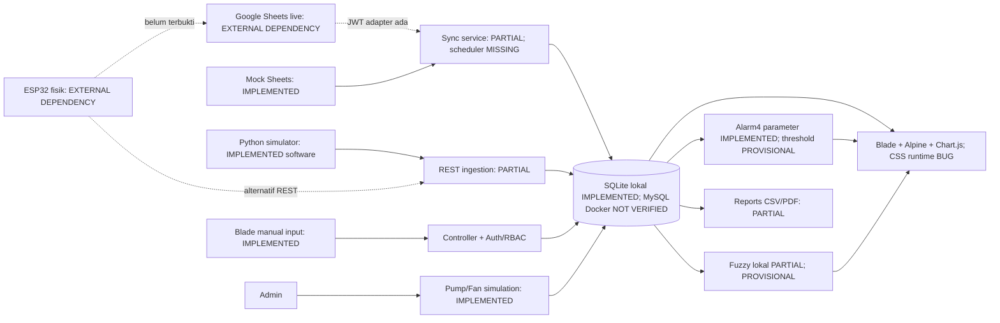

# IoT Integration Audit

Tanggal audit: **22 Oktober 2026 (Asia/Jakarta)**. Project: `D:\Compro`. Audit read-only terhadap kode aplikasi dan database utama; artefak audit disimpan di `docs/audit`.

## Arsitektur aktual dan status

PHP 8.2.12, Laravel 11.57.0, Blade/Alpine/Chart.js/Vite tersedia. Tailwind4 terpasang tetapi styling runtime gagal. Service layer ada untuk alarm, fuzzy, actuator, Sheets dan reports; CRUD controller langsung Eloquent. Tidak ditemukan jalur dari fuzzy/simulation ke relay fisik. Bukan arsitektur closed-loop hardware yang sudah beroperasi.

| Lapisan verifikasi | Status | Bukti |
| --- | --- | --- |
| Mock integration | VERIFIED (software only) | GoogleSheetsTelemetryAndSecurityTest, JUnit237pass; mock tidak menghubungi Google. |
| Sandbox Sheets | NOT VERIFIED | Tidak ada sandbox eksternal disediakan. |
| Live Google Sheets | EXTERNAL DEPENDENCY | Runtime mode=mock, spreadsheet_id_present=false, credentials_present=false. |
| Physical ESP32 | EXTERNAL DEPENDENCY | Tidak ada firmware log, serial trace, screenshot cloud atau sesi uji hardware. |
| Agronomic acceptance | PROVISIONAL | Threshold/rule belum disahkan. |

## Kontrak data

| Sheet index/header | DB field | Validasi Sheets / perbedaan API |
| --- | --- | --- |
| A device_id | device_id | Required tetapi registry aktif/revoked tidak diperiksa. |
| B timestamp | monitored_at | Multiple Carbon formats/Jakarta; fallback parser permisif. |
| C plant_code | plant_id | Nama/lokasi/ID; unknown diam-diam memakai tanaman aktif pertama. |
| D temperature | temperature | 0–60°C required; cocok rentang API. |
| E humidity | humidity | 0–100% required. |
| F soil_moisture | soil_moisture | 0–100% required Sheets, nullable API. |
| G ph | ph | 0–14 required; SRS optional belum dipenuhi. |
| H ec | ec | Optional0–10mS/cm, API0–20. |
| I light_intensity | light_intensity | Optional0–100000lux, API0–200000. |
| J nutrient_temp | nutrient_temperature | Optional0–60°C, nama berbeda dari API. |
| K tank_level | tank_level | Optional0–100%; blueprint water_tank_level tidak dipetakan API. |
| L/M pump_status/fan_status | reported_pump_state/reported_fan_state | ON/OFF/null; tidak mengubah simulation_state. |
| N/O fuzzy_score/fuzzy_label | fuzzy_score/fuzzy_label + inference history | Optional; score0 gagal dipreservasi pipeline. |

EXPECTED_HEADERS15 tersedia; sync membaca positional A:O tanpa validasi header live. Config data_range/polling_interval belum berarti scheduler aktif. Auth adapter dipilih dari config services, bukan otomatis dari setiap record auth_mode. is_active config tidak terlihat sebagai guard awal di sync.

## Sinkronisasi, dedup dan recovery

Cursor last_synced_row+1 aman hanya bila append-only yang ditegakkan. Insert/edit/sort di posisi lama tidak dibaca; row invalid memajukan cursor dan tidak otomatis dicoba ulang setelah diperbaiki. Reset cursor admin tersedia dan diuji, tetapi merupakan recovery eksplisit. Dedup sequential PASS; source_identifier tidak unique dan fallback plant+timestamp dapat membuang event perangkat berbeda. Lock60detik tidak membuktikan exclusion untuk job lebih lama atau distributed concurrency.

Adapter OAuth JWT ada; timeout10detik default dan retry3 untuk ConnectionException. HTTP429/5xx fetch tidak memperoleh retry/backoff setara. Mock error tests memverifikasi logging/response, bukan membuktikan live network recovery. Sync logs tersedia, namun database utama memiliki0 log sehingga tidak ada bukti sesi live sebelumnya.

Manual admin sync dan command CLI ada. **Scheduled sync MISSING**: evidence/schedule.txt hanya inspire. Stale telemetry dapat ditampilkan; stale alarm FR32 belum dibuat. Device token hash/revoke bekerja pada REST, tidak otomatis berlaku ke jalur spreadsheet.

## Kesiapan integrasi

Belum siap live. Selesaikan event identity, mapping eksplisit, header/unit/range, credential sandbox, scheduler dan recovery terlebih dahulu setelah audit disetujui. Verifikasi mock→sandbox→live→fisik secara terpisah; jangan mengaktifkan relay pada audit. Semua conflict C01–C08 dicatat di laporan master.
