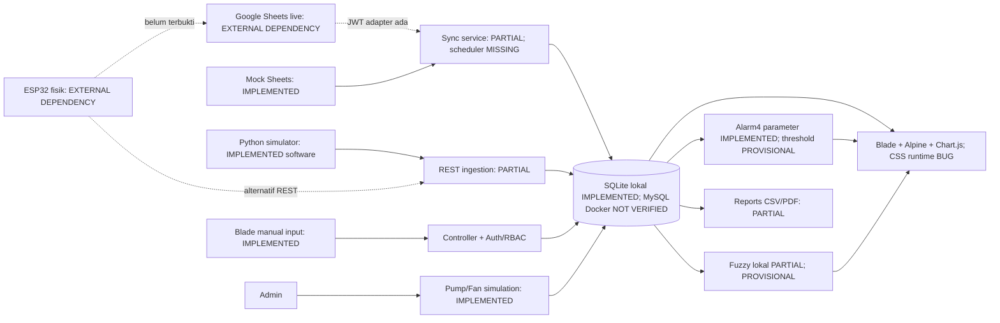

# MASTER PROJECT AUDIT — Sistem Web Monitoring Tanaman Melon

Tanggal audit: **22 Oktober 2026 (Asia/Jakarta)**. Project: `D:\Compro`. Audit read-only terhadap kode aplikasi dan database utama; artefak audit disimpan di `docs/audit`.

## A. Executive Summary

**Keputusan: NOT READY** untuk demonstrasi yang menyatakan kelengkapan SRS, deployment production, atau integrasi fisik. Project dapat di-boot lokal dengan dependensi yang sudah ada, tetapi tampilan hasil build rusak pada seluruh viewport dan ditemukan kesalahan analisis/akses data. Dasar keputusan bukan jumlah file atau klaim fase lama.

Yang berfungsi pada lingkup software: login/logout, pembatasan admin web, CRUD tanaman, sebagian besar monitoring, delapan field sensor, alarm4 parameter, matematika Mamdani, simulasi pompa/kipas, laporan dan CSV. Suite existing **237 tests/15.133 assertions PASS** pada salinan database. Namun probe di luar suite membuktikan API baca guest200, API duplikat201 dua kali, skor eksternal0 menjadi86.17, toggle fuzzy tidak berlaku ke API, serta filter ringkasan tidak konsisten.

Tidak ada perubahan kode aplikasi, threshold, fuzzy rules, SRS, atau database utama; pengujian mutasi memakai SQLite memori/salinan. Hash database utama diverifikasi kembali pada penutupan.

## B. Overall Feature Completeness

| Dimensi | Metode | Numerator / denominator | Hasil |
| --- | --- | --- | --- |
| Implementation completeness (indikatif) | COMPLETE/BUG=1 (fitur ada), PARTIAL=0.5, lainnya0; tidak setara berhasil | 317.5 / 407 | 78.0% |
| Functional verification coverage | Bobot kontrol dengan perilaku diuji (PASS ataupun FAIL); static-only tidak dihitung | 303 / 407 | 74.4% |
| Verified functional completeness | Hanya kontrol audit COMPLETE; PARTIAL/BUG/NV/eksternal0 | 210 / 407 | 51.6% |
| Requirement compliance SRS | Requirement COMPLETE saja, termasuk requirement hilang/opsional dalam denominator | 81 / 283 | 28.6% |
| External integration readiness | 5 gerbang bobot5: mock pipeline PASS; sandbox/live/physical/agronomy belum PASS | 5 / 25 | 20.0% |

Denominator kontrol: **117**, bobot **407**; SRS: **89**, bobot **283**. Bobot critical5/high3/medium2/low1. Bobot ditetapkan per kontrol sebelum agregasi, tercantum JSON. Metrik implementation mengukur keberadaan implementasi termasuk bug sehingga harus dibaca bersama verified completeness; bukan klaim fitur COMPLETE. Functional coverage mengukur eksekusi, bukan keberhasilan. External readiness memakai gerbang eksplisit, bukan persentase hardware terpasang.

| Status kontrol | Jumlah |
| --- | --- |
| COMPLETE | 61 |
| PARTIAL | 21 |
| MISSING | 5 |
| BUG | 19 |
| NOT VERIFIED | 6 |
| EXTERNAL DEPENDENCY | 5 |

## C. Module Status

| Modul | COMPLETE | PARTIAL | MISSING | BUG | NOT VERIFIED | EXTERNAL DEPENDENCY | Penilaian modul |
| --- | --- | --- | --- | --- | --- | --- | --- |
| Autentikasi & akun | 5 | 1 | 2 | 0 | 0 | 0 | PARTIAL |
| Dashboard | 4 | 2 | 0 | 1 | 0 | 0 | BUG / PARTIAL |
| Delapan sensor | 7 | 1 | 0 | 2 | 0 | 0 | BUG / PARTIAL |
| Tanaman | 7 | 1 | 0 | 0 | 0 | 0 | PARTIAL |
| Monitoring | 5 | 2 | 0 | 2 | 0 | 0 | BUG / PARTIAL |
| IoT & Sheets | 3 | 5 | 1 | 2 | 1 | 2 | BUG / PARTIAL |
| Alarm | 5 | 0 | 1 | 0 | 1 | 1 | PARTIAL |
| Fuzzy | 6 | 1 | 0 | 2 | 0 | 1 | BUG / PARTIAL |
| Aktuator simulasi | 5 | 0 | 0 | 0 | 1 | 1 | EXTERNAL DEPENDENCY |
| Grafik | 3 | 1 | 1 | 2 | 0 | 0 | BUG / PARTIAL |
| Laporan | 6 | 1 | 0 | 1 | 0 | 0 | BUG / PARTIAL |
| UI/UX | 0 | 1 | 0 | 4 | 1 | 0 | BUG / PARTIAL |
| Database | 3 | 2 | 0 | 0 | 1 | 0 | PARTIAL |
| Keamanan | 2 | 3 | 0 | 3 | 1 | 0 | BUG / PARTIAL |

## D. Missing Features

- AUTH-007: Daftar akun admin (FR-06).
- AUTH-008: Tambah/edit/nonaktif/hapus akun (FR-07 s.d. FR-10).
- IOT-011: Scheduled sync otomatis.
- ALARM-008: Manual resolve dan alarm buah matang FR-33/36.
- CHART-006: Grafik khusus fuzzy.

Tambahan SRS: pengamatan buah (daftar/create/edit/delete, kematangan, grafik dimensi/bobot, korelasi sensor, riwayat), telemetry summaries, alarm timeout, manual resolve, serta annotation tindakan aktuator. Lihat RTM seluruh FR01–62 dan 27 NFR.

## E. Partially Implemented Features

- AUTH-006: StoreMonitoringRequest::authorize mengizinkan semua user login; GET /monitorings/create pengamat 200. Konfirmasi izin pencatatan manual.
- DASH-005: Widget tersedia; query latestFuzzy tidak mengikuti date_from/date_to.
- DASH-007: Mode mock; tidak ada log sync lokal; stale telemetry berbeda dari status sinkronisasi sukses.
- SENSOR-004: pH wajib dan NOT NULL; bertentangan FR-20 yang mengizinkan null.
- PLANT-008: Guard hanya monitorings()->exists(); FK fuzzy/alarms plant cascade berisiko menghapus histori tersisa. Perlu kebijakan retensi.
- MON-003: Alur tersedia; updateOrCreate menimpa snapshot fuzzy pada versi/sumber sama, belum audit revisi immutable.
- MON-008: Tersimpan; pH nullable gagal, parse timestamp permisif dan uji zona waktu ekstrem belum lengkap.
- IOT-002: Ada implementasi; belum ada HTTP-fake menyeluruh untuk OAuth, refresh token dan response API nyata.
- IOT-004: A:O hardcoded, EXPECTED_HEADERS tidak memverifikasi header live, data_range konfigurasi diabaikan sync.
- IOT-008: Pre-check aplikasi, bukan unique constraint; fallback plant+timestamp dapat mengabaikan data perangkat lain.
- IOT-009: Fetch retry hanya ConnectionException; 429/5xx gagal tanpa retry terukur; invalid rows lewat cursor memerlukan reset eksplisit.
- IOT-012: Helper/widget stale tersedia; FR-32 alarm berhenti masuk belum ditemukan.
- FUZZY-008: Unique monitoring/rule/source + updateOrCreate menimpa hasil versi sama.
- CHART-003: Frequency/status global, fuzzy tanpa date filter; label global vs filtered perlu jelas.
- REPORT-006: File PDF valid A4 landscape dan 500 record, tetapi nomor halaman tidak dirender; legenda kategori fuzzy hardcoded tidak sama config.
- UI-004: Markup/pesan tersedia; screenshot tidak mendukung usability PASS karena CSS.
- DB-004: Source identifier dan alarm lookup bukan unique DB; race belum dibuktikan aman.
- DB-005: Set null monitoring menjaga sebagian histori; cascade plant dan overwrite fuzzy tetap perlu kebijakan.
- SEC-004: Throttle60 hanya POST ingestion; POST login dan GET API tidak dibatasi route.
- SEC-005: Framework protections tersedia; belum penetration test XSS/SQLi menyeluruh.
- SEC-007: Credential tidak dicetak di laporan; preset development dan akses .env/backup deployment belum hardening.

## F. Bugs & Issues

| ID | Priority | Masalah | Bukti |
| --- | --- | --- | --- |
| G01 | P0 | Style runtime rusak setelah build | resources/css/app.css: @tailwind base/components/utilities dengan Tailwind4.3.3; browser.json delapan overflow dan screenshot viewport. |
| G02 | P0 | Skor fuzzy eksternal nol ditimpa inferensi lokal | FuzzyPipelineService::process memakai !empty(score); probes.external_score_zero=86.17 BAIK. |
| G03 | P0 | API baca internal terbuka untuk guest | routes/api.php GET tanpa middleware auth; probes.guest empat status200. |
| G04 | P1 | REST ingestion menyimpan duplikat | Api/MonitoringController::store selalu create; probes.duplicate_api=201/201/count2. |
| G05 | P1 | Toggle fuzzy tidak mematikan ingress lokal | FuzzyPipelineService::process guard hanya laravel_engine; probe disabled_api tetap AVAILABLE. |
| G06 | P1 | Cursor Sheets melewatkan edit/insert/reorder dan perbaikan row error | GoogleSheetsSyncService::sync start last_synced_row+1, invalid turut memajukan cursor. |
| G07 | P1 | Mapping tanaman dan perangkat Sheets tidak ketat | resolvePlantId fallback pertama; parse menerima unknown device/plant; probes valid=true. |
| G08 | P1 | Ringkasan laporan tidak mengikuti filter | calculateAlarmSummary/calculateFuzzySummary hanya plant+tanggal; fuzzy tanggal inferred_at. Probe source kosong: 0 record,4 inference. |
| G09 | P1 | Kontrak API tidak cocok blueprint serta pH opsional gagal | Blueprint P116 payload422; required plant_height/plant_density; ph required dan NOT NULL; water_tank_level tak dipetakan. |
| G10 | P1 | Source manual dan simulator tidak dapat difilter tepat | Form tak set source; DB default manual; API selalu api; dropdown laporan web/api/google_sheets/simulator. |
| G11 | P1 | Scheduled synchronization belum ada | routes/console.php dan schedule:list hanya inspire. |
| G12 | P1 | Grafik tren memilih 30 observasi terlama | DashboardController::index orderBy ASC take30; probes.dashboard_trend. |
| G13 | P1 | Preset token development valid di production | IotDeviceSeeder tanpa environment guard; production probe201. Token tidak dicetak. |
| G14 | P1 | Login dan API GET belum rate limited | routes/web.php POST /login tanpa throttle; API GET tanpa throttle, index get() seluruh data. |
| G15 | P1 | Kebutuhan manajemen akun dan pengamatan buah belum dibuat | FR06–10,26,33,44–49,52; tidak ada resource user/fruit, /admin/users redirect. |
| G16 | P1 | Test bergantung database existing dan menyentuh file project jika default | phpunit.xml DB_DATABASE=database/database.sqlite; beberapa suite tanpa RefreshDatabase. Fresh memory204 failed,33 passed; isolated copy237pass. |
| G17 | P1 | Dependency security dan lifecycle Laravel | composer-audit.json 4 records/3 unique GHSA; Laravel 11.57.0. Dokumentasi resmi security support sampai12 Maret 2026. |
| G18 | P1 | Runtime MySQL dan concurrency belum diverifikasi | Local SQLite; Docker daemon tidak tersedia; source_identifier/alarm lookup tidak unique. |
| G19 | P2 | Fuzzy chart dan histori revisi belum lengkap | recentFuzzyScores tak dipakai view; updateOrCreate overwrite snapshot versi sama. |
| G20 | P2 | Retry/validation konfigurasi Sheets belum konsisten | retry fetch hanya connection error; ranges A:O; EC/light mismatch antar ingress; optional text menjadi null. |
| G21 | P2 | Preservasi data dan side effect GET | Dashboard GET getOrCreateDefaultConfig; FK plant cascade untuk fuzzy/alarm; delete guard hanya monitoring. |
| G22 | P1 | Legenda kategori fuzzy PDF salah dan nomor halaman hilang | PDF23 halaman: legenda PERLU_PERHATIAN40–70 dan BURUK0–45, config40–64.99 dan0–39.99; teks Halaman tidak ada. Template script text/php diabaikan karena enable_php=false. |

Detail dampak, rekomendasi, kompleksitas: FEATURE_GAP_ANALYSIS.md.

## G. Requirement Conflicts

| ID | Sumber yang bertentangan | Bukti aktual / keputusan yang diperlukan |
| --- | --- | --- |
| C01 | SRS fuzzy hanya di ESP32 vs Phase 15 fuzzy lokal Laravel | SRS revisi P122/P248; config/fuzzy.php dan pipeline lokal. Setujui peran analisis software terpisah dari controller ESP32. |
| C02 | SRS/blueprint ESP32→REST vs audit/Phase 14 ESP32→Sheets→Laravel | Pertahankan dua ingress berkontrak/provenance jelas atau tetapkan primary path secara formal. |
| C03 | SRS pH optional vs API/DB pH required | SRS FR20 P515; probe null422. Putuskan kontrak optional, bukan ubah narasi agar mengikuti bug. |
| C04 | Blueprint5 aktuator/closed-loop vs policy2 simulasi | Tidak ada dispatch hardware dalam layanan saat ini; hardware adalah dependency, bukan COMPLETE. |
| C05 | Blueprint/SRS alarm EC/tank vs policy4 parameter | FOUR_PARAMETER_ALARM_POLICY membatasi temperature/humidity/soil/ph. Keputusan stakeholder diperlukan; jangan hidupkan tank alarm/relay saat audit. |
| C06 | Threshold blueprint vs database aktual | Suhu ideal25–30 vs DB22–34; RH50–70 vs60–85; pH6–6.8 vs5.8–7.2; semuanya PROVISIONAL. |
| C07 | Pengamat read-only SRS vs create monitoring diizinkan | GET create200 dan StoreMonitoringRequest auth()->check(). Konfirmasi peran pencatatan pengamat. |
| C08 | Source manual/web/simulator dan field tank/nutrient tidak seragam | Sumber data tidak canonical; Sheets nutrient_temp→DB nutrient_temperature, blueprint water_tank_level vs tank_level. |
| C09 | Laporan sebelumnya mengklaim UI100% PASS dan fitur akun implemented | Screenshot saat ini rusak; /admin/users redirect; factory bukan workflow. Baseline terdahulu tidak membuktikan saat ini. |
| C10 | Jumlah requirement/test dilaporkan berbeda | SRS23 NFR vs aktual 27; RTM17. Phase 16:235/12391; Phase 16.1:237/14263; audit237/15133 pada salinan dataset. |

Tidak ditemukan bukti persetujuan stakeholder yang menyelesaikan konflik. Semua kesimpulan kesesuaian adalah terhadap dokumen yang tersedia, bukan pengesahan final.

## H. UI/UX Findings

Microsoft Edge/Playwright pada server terisolasi. 8 pemeriksaan dashboard/laporan; seluruhnya gagal visual. Komponen hadir, tetapi theme Tailwind hilang dan ikon menjadi sangat besar. Build PASS tidak membuktikan UI PASS.

| Viewport | Halaman | Lebar dokumen | Overflow | Hasil visual |
| --- | --- | --- | --- | --- |
| 375×812 | /dashboard | 484 | YA | FAIL — style/theme hilang |
| 375×812 | /reports/monitoring | 441 | YA | FAIL — style/theme hilang |
| 768×1024 | /dashboard | 877 | YA | FAIL — style/theme hilang |
| 768×1024 | /reports/monitoring | 834 | YA | FAIL — style/theme hilang |
| 1366×768 | /dashboard | 1475 | YA | FAIL — style/theme hilang |
| 1366×768 | /reports/monitoring | 1432 | YA | FAIL — style/theme hilang |
| 1920×1080 | /dashboard | 2029 | YA | FAIL — style/theme hilang |
| 1920×1080 | /reports/monitoring | 1986 | YA | FAIL — style/theme hilang |

Screenshot full-page dan viewport ada di evidence/. Aksesibilitas, UAT dan kompatibilitas Safari/Firefox belum diuji.

## I. IoT Integration Readiness

Mock software pipeline VERIFIED pada suite; sandbox NOT VERIFIED; Google Sheets live EXTERNAL DEPENDENCY (ID/kredensial tidak tersedia); ESP32 fisik EXTERNAL DEPENDENCY; agronomi PROVISIONAL. Record google_sheets atau device type ESP32 dalam database bukan bukti perangkat fisik. Scheduler sync belum ada.

## J. Security & Performance

API internal publik, preset dev token production, login tanpa throttle, dan dependency advisories memerlukan tindakan. Composer4 advisory records/3 GHSA unik; npm0 advisories pada saat scan. Laravel 11 security support resmi berakhir12 Maret 2026 ([Laravel release notes](https://laravel.com/docs/11.x/releases)); upgrade adalah perubahan rencana setelah persetujuan, tidak dilakukan pada audit ini.

Read API menggunakan get() seluruh record; chart raw limit30; summary hourly/daily belum ada. Durasi browser di browser.json adalah single-user local dengan server development/font eksternal, bukan benchmark p95/20 concurrent users. Tidak ada klaim performance NFR PASS atau production penetration-test PASS.

## K. Testing Evidence

- Baseline Phase 16 dilaporkan235 test/12.391 assertion/55 route; Phase 16.1 dilaporkan237/14.263.
- Aktual audit:237 PASS/15.133 assertions;55 route;11 migration Ran (SQLite); build PASS; Composer platform requirements PASS. Jumlah assertions dapat berubah mengikuti dataset existing.
- Database kosong memori:204 failed/33 passed/174 assertions karena no such table. Sebagian suite mengimpor RefreshDatabase tetapi tidak memakai trait/lifecycle schema mandiri.
- Probe independen memverifikasi kegagalan acceptance yang tidak dicakup suite.
- Browser web guest redirect, admin pages dan observer access dicatat di browser.json. PDF/CSV hasil aktual dijelaskan laporan UI/Test.

## L. Improvement Roadmap

1. Selesaikan blocker visual G01, preservasi skor0 G02, dan akses API G03; tambahkan regresi yang gagal sebelum perbaikan.
2. Tutup G04–G14 untuk integritas telemetry, provenance, filter, cursor, kontrak dan keamanan perangkat.
3. Pisahkan environment test dari data demo, verifikasi MySQL/concurrency, triage advisory dan upgrade runtime yang didukung.
4. Putuskan baseline SRS/Elektro, lalu lengkapi akun/pengamatan buah/grafik/timeout sesuai lingkup yang disetujui.
5. Jalankan sandbox/live Sheets, perangkat fisik dan pengesahan agronomi bersama Elektro; ulangi audit readiness.

## M. Final Decision

**NOT READY.** Boot lokal berhasil, tetapi bukti runtime menunjukkan blocker demo dan hasil analisis yang dapat menyesatkan. Tidak layak mengklaim seluruh SRS selesai atau hardware siap. Audit berhenti setelah laporan; perbaikan kode/Phase 17 menunggu persetujuan hasil audit sesuai instruksi pengguna.

## Lampiran — arsitektur dan data

PHP 8.2.12, Laravel 11.57.0, Blade/Alpine/Chart.js/Vite tersedia. Tailwind4 terpasang tetapi styling runtime gagal. Service layer ada untuk alarm, fuzzy, actuator, Sheets dan reports; CRUD controller langsung Eloquent. Tidak ditemukan jalur dari fuzzy/simulation ke relay fisik. Bukan arsitektur closed-loop hardware yang sudah beroperasi.

| Tabel | Jumlah record lokal |
| --- | --- |
| migrations | 11 |
| users | 10 |
| password_reset_tokens | 0 |
| sessions | 0 |
| cache | 0 |
| cache_locks | 0 |
| jobs | 0 |
| job_batches | 0 |
| failed_jobs | 0 |
| plants | 150 |
| monitoring_parameters | 10 |
| monitorings | 959 |
| monitoring_alarms | 1 |
| actuators | 3 |
| actuator_command_logs | 1 |
| iot_devices | 3 |
| google_sheets_sync_configs | 1 |
| google_sheets_sync_logs | 0 |
| fuzzy_inference_results | 493 |

Foreign-key check SQLite:0 pelanggaran. Sumber lokal: api=738, google_sheets=1, manual=153, web=67. Data lokal mengandung fixture/test labels dan tidak dianggap hasil sensor lapangan. Telemetri terakhir 2026-10-17 13:43:42, sehingga bukan data live saat22 Oktober 2026.

## Navigasi laporan

- [FEATURE_COMPLETENESS_MATRIX](FEATURE_COMPLETENESS_MATRIX.md)
- [REQUIREMENT_TRACEABILITY_MATRIX](REQUIREMENT_TRACEABILITY_MATRIX.md)
- [FEATURE_GAP_ANALYSIS](FEATURE_GAP_ANALYSIS.md)
- [UI_UX_AUDIT_REPORT](UI_UX_AUDIT_REPORT.md)
- [IOT_INTEGRATION_AUDIT](IOT_INTEGRATION_AUDIT.md)
- [FUZZY_LOGIC_AUDIT](FUZZY_LOGIC_AUDIT.md)
- [SECURITY_AUDIT_REPORT](SECURITY_AUDIT_REPORT.md)
- [TEST_COVERAGE_AUDIT](TEST_COVERAGE_AUDIT.md)
- [PROJECT_READINESS_ASSESSMENT](PROJECT_READINESS_ASSESSMENT.md)

## Inventaris sumber dan batas audit

Tiga DOCX kebutuhan berhasil dibaca melalui XML paragraf/tabel dan RTM XLSX melalui worksheet; tidak mengubah atau merender ulang dokumen sumber. Layout/diagram gambar dalam DOCX tidak diverifikasi secara visual. Ekstraksi mencakup SRS utama, spesifikasi akhir Elektro, dan SRS revisi docs/srs. Laporan Phase 13, 14, 15, 15.1, 16 dan 16.1 tersedia; laporan terpisah Phase 1–12 tidak ditemukan dengan nama fase, sehingga klaim historis fase tersebut NOT VERIFIED di luar kode/test aktual. README dan dokumen arsitektur/integrasi/requirements menjadi sumber tambahan. Dokumen bertanda APPROVED tidak dianggap bukti tanda tangan stakeholder yang menyelesaikan konflik.

Scope browser mencakup admin navigation, akses pengamat/guest dan delapan screenshot viewport utama; bukan seluruh tombol pada semua halaman. Mutation UI memakai suite/probe database terisolasi. PDF dibaca seluruh teksnya, visual sampel 1/12/23; halaman lain belum diperiksa visual satu per satu. Semua batas ini menahan klaim COMPLETE menyeluruh.

G22 tambahan: footer nomor halaman PDF hilang dan legenda kategori tidak sesuai config; lihat gap analysis. Hash database utama sama sebelum/sesudah (evidence/database-integrity.json).

## Addendum — Phase16.3,24 Oktober2026

Laporan di atas adalah snapshot audit22 Oktober dan tetap dipertahankan. Phase16.2 memperbaiki keamanan API/deduplikasi/fuzzy0; Phase16.3 kini **PASS untuk UI lokal yang diverifikasi**:40 halaman-viewport tanpa overflow,52 interaksi browser,297 test/2075 assertions,build PASS,dan gate MySQL8.0.46 PASS. Temuan CSS G01 ditutup dalam lingkup tersebut. Data utama18 tabel tetap identik.

Lihat [implementasi Phase16.3](../PHASE_16_3_IMPLEMENTATION_REPORT.md) dan [perbandingan screenshot](../phase16_3/visual-comparison.html). **Kesiapan keseluruhan tetap NOT READY**: gap kebutuhan/backend di luar fase,production security,Sheets live,perangkat fisik dan validasi agronomi belum ditutup. Tidak memulai Phase16.4.
